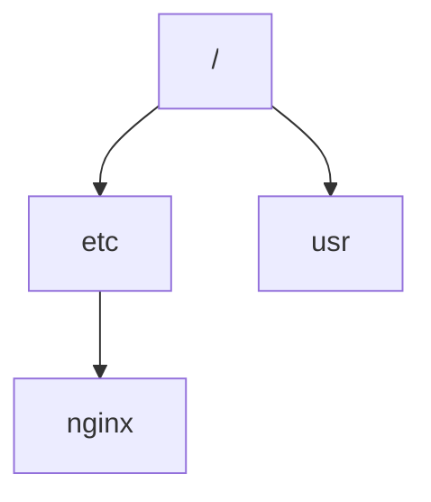

# drf-hierarchy

[](https://www.gnu.org/licenses/gpl-3.0)
[](https://github.com/gmork2/drf-hierarchy/actions/workflows/ci.yml)
[](https://github.com/gmork2/drf-hierarchy/actions/workflows/release.yml)
[](https://pypi.org/project/drf-hierarchy/)
[](https://www.python.org/)
[](https://www.djangoproject.com/)
[](https://www.django-rest-framework.org/)
[](https://semver.org/)

`drf-hierarchy` is a reusable Django app that adds **hierarchical group permissions**
on top of Django `auth.Group` using **MPTT** (tree structure).

It is designed for projects where permissions should be inherited through a group tree
(for example: organization units, tenants, folders, or role hierarchies).

## What problem this app solves

By default, Django groups are flat. This app provides:

- A tree model (`MPTTGroup`) that wraps `auth.Group`.
- Permission inheritance across parent/child nodes.
- A DRF endpoint to expose/manage the hierarchy.
- Admin integration with tree visualization.
- Validation guards for circular references and max children constraints.

## Compatibility

- Python: `>=3.10,<3.13`
- Django: `>=4.2,<7.0`
- djangorestframework: `>=3.15,<3.17`
- django-mptt: `>=0.16,<1.0`

Validated test matrix in this repository:

- Django 4.2.x
- Django 5.x
- Django 6.x

## CI/CD

- **CI** (`.github/workflows/ci.yml`): lint, Django checks and tests on push/PR, plus compatibility matrix across Django 4.2/5.x/6.x.
- **CD** (`.github/workflows/release.yml`): on GitHub Release publication, builds the package and publishes to PyPI.

## Versioning (SemVer)

This project follows **Semantic Versioning** using `X.Y.Z` in `pyproject.toml` and tags in the form `vX.Y.Z`.

- `MAJOR` (`X`): backward-incompatible API/behavior changes.
- `MINOR` (`Y`): backward-compatible features.
- `PATCH` (`Z`): backward-compatible fixes.

Automated checks:

- CI validates that `project.version` uses SemVer core format.
- Release workflow validates that release tag `vX.Y.Z` matches `project.version`.

Recommended release flow:

1. Update `project.version` in `pyproject.toml`.
2. Merge to `main`/`master`.
3. Create tag `vX.Y.Z` on that commit.
4. Publish GitHub Release for that tag.

## Installation

### Recommended (uv)

```bash
uv add drf-hierarchy
```

For local development of this repository:

```bash
cp .env.example .env
uv sync --group dev
uv run python scripts/bootstrap_sample.py
uv run python manage.py runserver 0.0.0.0:8000 --settings=sample.settings
```

### Alternative (pip)

```bash
pip install drf-hierarchy
```

## Running the sample project

This repository includes `sample/`, a minimal Django project used to validate and demonstrate integration of the `hierarchy` app. It is intended for local testing and examples (not production).

### Start `sample` locally

```bash
cp .env.example .env
uv sync --group dev
uv run python scripts/bootstrap_sample.py
uv run python manage.py runserver 0.0.0.0:8000 --settings=sample.settings
```

`bootstrap_sample.py` is non-interactive and idempotent:

- Runs migrations.
- Creates a superuser if missing.
- Reuses existing superuser if already present.

Credentials are read from environment variables in `.env`:

- `DJANGO_SUPERUSER_USERNAME`
- `DJANGO_SUPERUSER_EMAIL`
- `DJANGO_SUPERUSER_PASSWORD`

Optional sample data fixture:

- Set `SAMPLE_LOAD_FIXTURE=true` in `.env`, then run:

```bash
uv run python scripts/bootstrap_sample.py
```

This loads `sample/fixtures/linux_hierarchy.json` (Linux-like hierarchy) only when no hierarchy nodes exist.

### Verify it is working

- Admin: `http://127.0.0.1:8000/admin/`
- API root: `http://127.0.0.1:8000/`
- Hierarchy endpoint: `http://127.0.0.1:8000/hierarchy/`

Quick health checks:

```bash
uv run python manage.py check --settings=sample.settings
uv run pytest -q
```

### Quickstart: minimal hierarchy example

If you want to see permission inheritance quickly, this reduced example mirrors the shape of the Linux-like fixture:



Load the full sample fixture (optional):

```bash
SAMPLE_LOAD_FIXTURE=true uv run python scripts/bootstrap_sample.py
```

Or create a minimal tree manually:

```bash
uv run python manage.py shell --settings=sample.settings
```

```python
from django.contrib.auth.models import Group
from hierarchy.models import MPTTGroup

root = MPTTGroup.objects.create(group=Group.objects.create(name="/"))
etc = MPTTGroup.objects.create(group=Group.objects.create(name="etc"), parent=root)
MPTTGroup.objects.create(group=Group.objects.create(name="nginx"), parent=etc)
MPTTGroup.objects.create(group=Group.objects.create(name="usr"), parent=root)
```

The full fixture is available at `sample/fixtures/linux_hierarchy.json`.

## Integrating into an existing Django project

### 1. Add installed apps

```python
INSTALLED_APPS = [
    # ...
    "rest_framework",
    "mptt",
    "hierarchy",
]
```

### 2. Enable authentication backend

```python
AUTHENTICATION_BACKENDS = [
    "django.contrib.auth.backends.ModelBackend",
    "hierarchy.backends.MPTTGroupBackend",
]
```

`MPTTGroupBackend` augments Django group permission resolution by traversing the hierarchy.

### 3. Run migrations

```bash
python manage.py migrate
```

### 4. Expose API routes (optional but recommended)

```python
from django.urls import path
from rest_framework import routers
from hierarchy.views import MPTTGroupViewSet

router = routers.DefaultRouter()
router.register("hierarchy", MPTTGroupViewSet)

urlpatterns = [
    path("admin/", admin.site.urls),
] + router.urls
```

## Configuration

The app supports these settings:

```python
# Traversal method used to compute inherited permissions.
# Must be one of:
# get_ancestors, get_children, get_descendants, get_family,
# get_next_sibling, get_previous_sibling, get_root, get_siblings
HIERARCHY_MPTT_METHOD = "get_descendants"

# Max serialized depth for recursive children in API responses.
HIERARCHY_MAX_SERIALIZATION_DEPTH = 5

# Optional global maximum number of children per node (project-defined usage).
HIERARCHY_MAX_CHILDREN = None
```

Notes:

- `HIERARCHY_MPTT_METHOD` is validated at startup.
- `HIERARCHY_MAX_SERIALIZATION_DEPTH` prevents unbounded recursive payloads.

## Data model and behavior

`MPTTGroup` fields:

- `group` (`OneToOne` with `auth.Group`)
- `parent` (tree parent)
- `inheritable` (whether node permissions are inheritable)
- `max_children` (per-node children limit)
- `active`, `propagate` (state fields)

Validation rules:

- A node cannot be its own parent.
- A node cannot set one of its descendants as parent.
- Parent `max_children` is enforced.

## Security and production guidance

This repository includes a `sample` project for demos/tests.

Before deploying any real project:

- Set `DEBUG=False`.
- Use a strong `SECRET_KEY`.
- Configure `ALLOWED_HOSTS`.
- Enable secure cookies and HTTPS/HSTS settings.
- Run:

```bash
python manage.py check --deploy
```

The included `.env.example` shows secure-related variables you can set.

## Development workflow (this repository)

```bash
uv sync --group dev
uv run ruff check .
uv run pytest
uv run python manage.py check --settings=sample.settings
uv run python manage.py check --deploy --settings=sample.settings
```

## Admin usage

The app registers `MPTTGroup` in Django admin using `DraggableMPTTAdmin`, so the hierarchy can be managed visually.

## API overview

Default `sample` API route:

- `GET /hierarchy/` root hierarchy nodes
- standard DRF `ModelViewSet` actions for CRUD

Access is protected by `DjangoModelPermissions`.

## License

GPLv3. See `LICENSE`.
